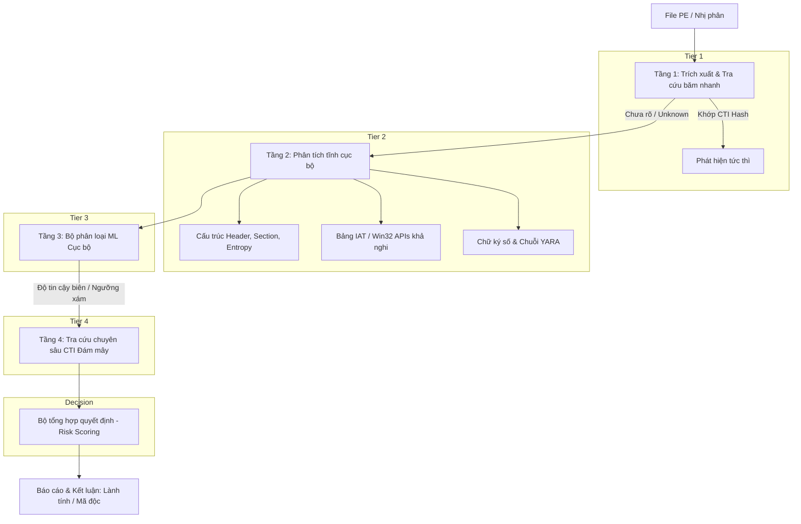

# Kiến trúc Hệ thống Phát hiện Mã độc Lai (Hybrid Malware Detector)

Mô hình lai kết hợp phân tích tĩnh tại chỗ (Local Static Analysis) và tra cứu tri thức mối đe dọa đám mây (Cloud Threat Intelligence - CTI) là giải pháp cân bằng tối ưu giữa độ trễ xử lý, bảo mật quyền riêng tư và khả năng phát hiện các biến thể mã độc đã biết lẫn mối đe dọa mới (Zero-day/Unknown).

## 1. Kiến trúc tổng thể và luồng xử lý
Hệ thống hoạt động theo nguyên tắc lọc phân tầng (Tiered Filtering) để tối ưu hóa tài nguyên phần cứng cục bộ và hạn chế vượt ngưỡng giới hạn yêu cầu (API Rate Limit) của dịch vụ đám mây:

## 2. Các tầng phân tích chi tiết

### Tầng 1: Kiểm tra tính toàn vẹn và tra cứu băm tức thì
*   **Mục tiêu:** Phát hiện nhanh các mẫu đã biết trong vài mili-giây mà không tốn chi phí tính toán.
*   **Kỹ thuật:**
    *   Tính toán mã băm tiêu chuẩn: MD5, SHA-1, SHA-256.
    *   Tra cứu qua Local Cache/Blocklist hoặc truy vấn nhanh CTI endpoint để kiểm tra điểm danh tiếng (Reputation Score).
*   **Kết quả:** Nếu SHA-256 đã có lịch sử độc hại rõ ràng, gắn cờ ngay lập tức; nếu chưa có thông tin, chuyển tiếp sang Tầng 2.

### Tầng 2: Phân tích tĩnh PE cục bộ (Local Static PE Analysis)
Trích xuất thông tin cấu trúc tệp nhị phân mà không cần thực thi mã:
*   **Entropy của Section:** Tính độ hỗn loạn thông tin. Chỉ số > 7.0 là dấu hiệu của việc nén (packing), mã hóa (obfuscation).
*   **Bảng nhập khẩu (IAT):** Nhận diện các Win32 API bị lạm dụng:
    *   *Process Injection:* VirtualAllocEx, WriteProcessMemory...
    *   *Anti-Debugging:* IsDebuggerPresent...
*   **Cấu trúc PE Headers & Sections:** Kích thước lệch bất thường (VirtualSize vs RawSize), section thực thi bất thường.

### Tầng 3: Phân loại dựa trên Machine Learning cục bộ
*   **Đặc trưng đầu vào:** Kết hợp các vector từ Tầng 2.
*   **Mô hình triển khai:** Random Forest (train trên Kaggle/EMBER).
*   **Ngưỡng quyết định (Probability P):**
    *   `P ≥ 0.85`: Malicious
    *   `P ≤ 0.15`: Benign
    *   `0.15 < P < 0.85`: Vùng nghi ngờ (Suspicious) → Kích hoạt Tầng 4.

### Tầng 4: Tra cứu tri thức mối đe dọa đám mây (CTI)
*   **Dịch vụ tích hợp:** VirusTotal API v3, AlienVault OTX.
*   **Dữ liệu thu thập:** Tỉ lệ phát hiện đa engine, Lịch sử phát hiện, Thông tin IOCs.
*   **Chính sách riêng tư:** Tuyệt đối chỉ gửi mã băm (Hash/Imphash).

## 3. Cơ chế tổng hợp quyết định (Decision Engine)
Hệ thống đưa ra kết luận thông qua mô hình chấm điểm rủi ro có trọng số:

$$Risk\_Score = (0.25 \times S_{static}) + (0.35 \times P_{ml}) + (0.40 \times S_{cti})$$

| Thành phần | Trọng số (w) | Tiêu chí tính điểm (S) |
| :--- | :---: | :--- |
| **Phân tích tĩnh ($S_{static}$)** | 0.25 | Dựa trên số lượng API nguy hiểm, section entropy cao, packer signature. |
| **Mô hình ML ($P_{ml}$)** | 0.35 | Xác suất phân loại độc hại từ Random Forest. |
| **Đám mây CTI ($S_{cti}$)** | 0.40 | Tỷ lệ engine cảnh báo độc hại và mức độ uy tín của nguồn tin. |

**Quy tắc quyết định:**
*   `Score ≥ 0.70`: Phân loại **Malicious** (Cách ly/Cảnh báo đỏ).
*   `0.40 ≤ Score < 0.70`: Phân loại **Suspicious** (Gợi ý phân tích động / Sandbox).
*   `Score < 0.40`: Phân loại **Benign** (Cho phép thực thi).
